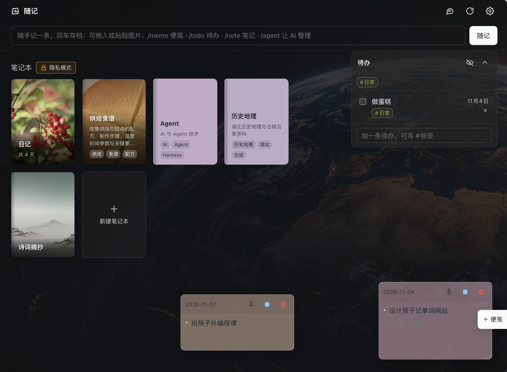
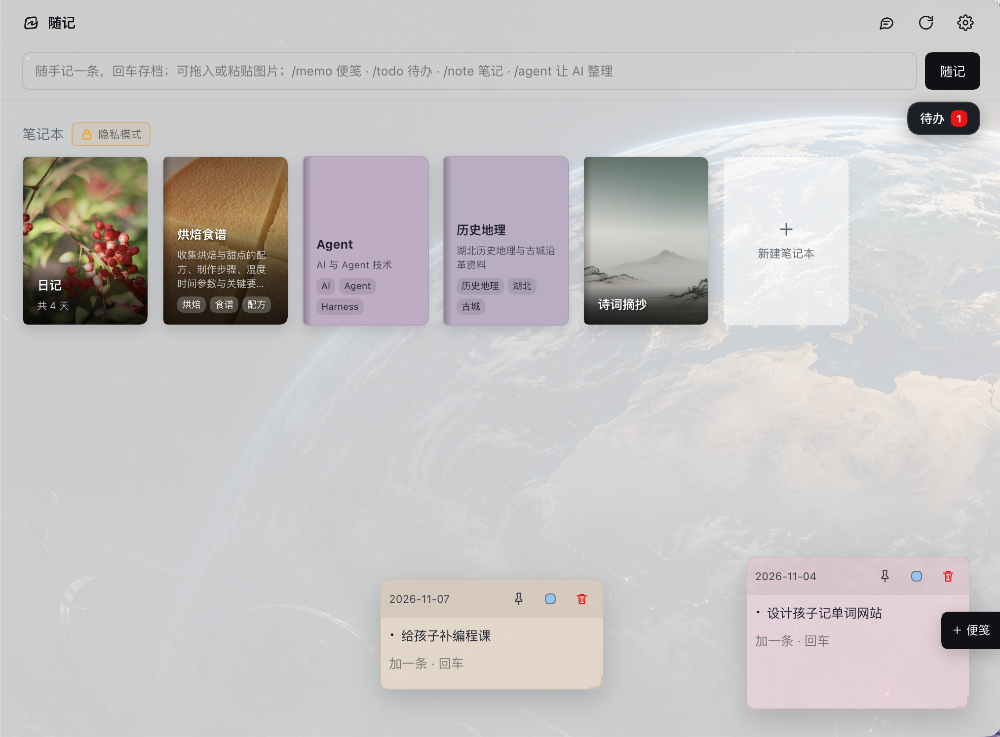

# 随记

<p align="center">
  
</p>

<p>
  
  
  
</p>

记一句就走，整理交给 AI。

随记是 DSH 的本地笔记插件。它把随手记和长期整理放在同一条流程里：顶部输入一句话，先落进今天的日记，再由模型判断该归到哪本笔记本、哪篇笔记；确认归档后才写入。素材积累起来以后，还能让 `/agent` 读取已有内容，把零散想法整理成文章。

## 它解决什么问题

多数笔记工具要求你在记录时就想好放哪本、起什么标题、打什么标签。灵感常常断在这一步。

随记把顺序倒过来：

1. 先把话记下来，不用选择。
2. AI 根据已有笔记本和笔记生成归档方案，确认后归档。
3. 归错了，一键改归属。
4. 素材够了，再让 AI 帮你合并、改写、成文。

记录时只做一个动作，整理留到后面。查资料、问 AI 得到的结论，也可以通过 MCP 直接沉淀成笔记。

## 亮点

### 记录时不打断思路

顶部输入框常驻。按 Enter 立即写进今日日记，不用先建笔记、选目录、想标题。后台先完成分类和暂存，确认后写入笔记，并在日记条目后面补一个链接。

### 素材会慢慢长成文章

日记、主题笔记和快捷记录都在本地。`/agent` 会把当前页面相关的笔记作为上下文，可以完成这些事：

- 把几篇零散笔记合并成一篇新文章；
- 根据一周日记写复盘；
- 按你的观点重写一篇旧笔记；
- 给一组笔记重新起名、排序、补标签和摘要；
- 把对话里聊出来的结构，落成一篇正式笔记。

它更像一个能读当前素材的编辑，可以接着已有内容往下写。

### 每次查询都能沉淀

MCP 让 DSH 或其他 AI 会话直接读写随记。查资料、问概念、做一次选型比较，结论可以顺手整理成笔记，不用等关掉会话后再凭记忆补记。

### 本地 Markdown，随时可迁移

笔记就是普通 `.md` 文件，目录结构清晰，随时可以用别的编辑器打开、备份、迁移。插件只额外维护一个 `.dsh-notebooks.json` 清单和隐藏的 `.dsh-notebooks/` 数据目录。

### 日记、笔记、便笺、待办放在一起

灵感、资料、临时便笺、待办提醒在同一个空间里。需要写东西时，素材就在旁边。

## 演示视频

<video src="./assets/suiji-demo.mp4" controls muted playsinline width="100%"></video>

[如果视频无法播放，点此下载](./assets/suiji-demo.mp4)

视频展示随记的快捷记录、日记归档、笔记管理和 Agent 协作流程。

### 首页

深色模式：



浅色模式：



## 功能

### 快捷记录与自动归档

- 在首页顶部输入框写内容，Enter 保存，Shift+Enter 换行。
- 先写当天日记，再异步分类并生成归档确认；确认后才写入主题笔记本。
- 归档状态直接标在日记条目上：归档中、已归档、待确认、失败。
- 失败会进入队列，下次打开、回到首页或手动重试时再次执行。
- 归错了可以「修改笔记本」，只换归属，不重写内容；现有笔记本都不合适时，可以在弹窗里直接新建一本。
- 长记录会保留原文细节，不压缩成摘要；短记录允许模型顺句润色。
- 如果追加后读起来不顺，短笔记会给出整篇改写建议；长记录保留原文，长文改写结果会先进入待审阅，不会只写入半篇内容。

### 日记

- 按日期分段、新的在上的 Markdown 文档。
- 一册写满约 5000 行后，下一天自动开新册。
- 月历查看，单月/双月切换，有记录的日期数字用主题色高亮。
- 点日期直接跳到对应段落。

### 主题笔记本

- 笔记本以书本卡片呈现，可上传封面、拖动排序。
- 笔记本管理页修改后自动保存；删除按钮在左下角，点击后会二次确认。
- 笔记本可设为隐私笔记本，封面上会带一个锁标。
- 笔记标题就是文件名，改名会同步更新日记里的链接。
- 移动笔记时，同目录的图片会一起移动，Markdown 引用路径同步更新。
- `/agent` 整理笔记时默认保留所有图片引用；要移除图片会先请你确认。确认后还会检查其他笔记是否仍引用该图片，没有引用才删除文件。
- 笔记列表带序号，可拖动排序，排序会持久保存。
- 在 Markdown 阅读和纯文本编辑之间切换，停止输入 800 毫秒后自动保存。
- 文件被外部修改时会提示冲突，可以保留本地或载入磁盘。
- 删除的笔记会进入废纸篓，可撤销。
- 首页「笔记本」标题后有隐私模式开关；开启后只隐藏隐私笔记本，不影响快捷记录和 `/agent`。它只是界面隐藏，不加密文件。隐私状态和开关也可以交给 `/agent` 修改。

### `/agent`：让 AI 整理笔记、待办和便笺

在快捷输入框里输入 `/agent` 加指令。不同页面能读到的文件不同：

- 首页：读取各笔记本的信息和笔记标题、frontmatter，不读正文；
- 笔记本：读取该本笔记；
- 笔记：读取当前这篇；
- 日记：读取最近几册。

在咖啡笔记本里：

```text
/agent 把咖啡这本里关于手冲的笔记合并成一篇《手冲入门》，放到咖啡笔记本
```

在日记页：

```text
/agent 根据最近几册日记写一篇复盘，重点写做决定的过程，不要流水账
```

在任何页面：

```text
/agent 查看当前所有定时提醒任务
```

```text
/agent 给待办里和装修有关的事项加上“装修”标签
```

```text
/agent 关闭自动归档，把待办卡片透明度调到 40%
```

```text
/agent 把「个人」设为隐私笔记本，并开启首页隐私模式
```

```text
/agent 把 A 目录下的 old.png 移到 B 目录的 new.png
```

它能做的事不止写正文：

- 新建、写入、改名、删除、移动笔记；
- 新建、改名、删除笔记本；
- 调整笔记和笔记本顺序；
- 更新标签和摘要；
- 移动、复制笔记目录下的图片等非 Markdown 附件；
- 新增、修改、删除待办；
- 新建、修改、删除、固定便笺；
- 读取和修改设置；
- 设置笔记本的隐私状态，开关首页隐私模式。

它也能直接改设置，例如关闭自动归档、调整音量、改便笺透明度、切换提醒声音性别、更换模型。移动或复制附件时，目标文件已存在会拒绝覆盖；图片改名后需要让 `/agent` 同步改 Markdown 引用。数据目录不能通过 `/agent` 修改；自定义背景图和提醒音效文件仍要在设置页上传，`/agent` 可以把它们恢复默认。设置修改会一起进入撤销快照。

单篇删除、单篇移动和改名默认直接执行；一次删除多篇、一次移动多篇、正文达到 500 字和整篇改写必须先确认。暂存操作会先给改动简报，确认后才落盘。执行完可以整批撤销；撤销前会校验笔记、待办和配置是否已有新改动，发现冲突会拒绝覆盖。需要读取或改写正文时，先打开对应笔记或笔记本。模型每次读取的内容量都受上下文窗口限制。

`/agent` 会分多轮完成长任务，可能分多次读取、整理和暂存。任务进行中会显示进度；达到处理上限时会询问是否继续。改动进入审阅后，确认才会落盘。

需要你在几个方案里做决定时，agent 会把选项写进 `options`，提示卡片直接显示方案按钮；点一下就带着选择继续这次对话，不需要手动复制 A/B。

### 把碎片变成文章

一种实际用法：

1. 平时看到资料、句子、想法，直接写进顶部输入框，让 AI 自动归档。
2. 想写东西时，先在 DSH 对话里聊结构，或者直接打开相关笔记本。
3. 用 `/agent` 让它读取当前页面和已有笔记，生成初稿或合并稿。
4. 在随记里读、改、补，满意后保存。

比如，先把大纲落成一篇笔记：

```text
/agent 读一下这个笔记本里的素材，找三个能串起来的主题，新建笔记《手冲文章大纲》，把大纲写进去
```

再让下一次 `/agent` 按这篇大纲写正文：

```text
/agent 按《手冲文章大纲》写一篇 1500 字左右的文章，新建笔记《为什么我重新开始手冲》
```

打开新文章后，可以继续改语气：

```text
/agent 把这篇里太像口号句的地方删掉，保留具体细节，语气更冷静
```

### 便笺

- 每张便笺一个文件，放在 `便笺/`。
- 在首页可自由拖动、八向缩放，位置和尺寸会记住。
- 可改颜色、固定到子页、最小化成小球。
- 未聚焦时背景半透明，点进去恢复不透明。
- 透明度可在设置里调。

### 待办与提醒

- 待办卡片固定在首页右上角，支持隐藏已完成项和按标签筛选。
- 待办内容里出现明确时间会创建提醒，例如：
  - `今晚 6 点提醒我上课`
  - `每隔 45 分钟提醒我喝水`
  - `明天 10 点提醒我开会`
- 支持一次性、间隔、每天、每周提醒。
- 提醒卡片在随记窗口右上角弹出；开启系统通知后，系统通知会出现在屏幕右上角。
- 周期提醒可以单独停止，不影响其他提醒。
- 提醒音效、朗读语音和各自音量都可以在设置里调整。

### 外观与设置

- 内置地球壁纸，也可以上传自己的首页背景。
- 首页背景会同时用于提醒卡片。
- 笔记本封面、日记封面都可单独设置。
- 设置项即时生效，没有保存按钮。
- 模型服务、provider 和 model 可从 DSH 已配置的服务中选择。

### MCP：让 AI 读写随记

随记内置一个本地 HTTP MCP 服务，可以让 AI Agent 读写和管理你的笔记，包括 DSH 自己的会话。

它不只适合“让 AI 记一条”，也可以把随记当成 Agent 的外部资料库：

- Agent 先查资料、读网页、跑自己的工具；
- 再把总结、结论或整理结果写入随记；
- 也可以反过来读取你已有的笔记，做跨笔记综合、对比和再整理；
- 待办、便笺同样可以通过 MCP 管理。

#### 让一次问答留下结果

很多问题是在 AI 会话里随手问的：一个概念、一段报错、一次选型比较。答案当时有用，关掉会话后却很难再找回来。

连接 MCP 后，可以在同一次会话里接着说：

```text
把刚才关于向量数据库选型的结论整理成一篇笔记，
标题叫《向量数据库选型记录》，
写进 Agent 笔记本，并列出你参考过的来源。
```

Agent 会把对话里的结论、对比和来源整理成 Markdown，通过 MCP 写入随记。下次再遇到同类问题，可以直接搜到当时的判断，而不是重新问一遍。

适合这样记录的内容：

- 一次技术选型的比较和结论
- 一段报错的排查过程
- 一篇文章、一本书的要点
- 一次方案讨论后的决定
- 临时查到、以后还会用到的资料

这样，每次查询都会留下可检索的结果，而不是停在会话记录里。

#### 连接

打开随记设置页，在「外部连接」里可以看到：

```text
MCP 地址
Token
安装 Skill
```

默认地址类似：

```text
http://127.0.0.1:53152/dsh-agentic-notes/mcp
```

以设置页实际显示为准。AI Agent 使用：

```text
Authorization: Bearer <Token>
```

MCP 仅监听本机，不会暴露到公网。

#### 安装 Skill

点击「安装 Skill」，会把 `suiji-note` 安装到：

```text
~/.agents/skills/suiji-note/
```

之后支持 Skill 的 AI 可以直接按技能说明连接，不需要你手动解释协议。

安装后可以这样对 Agent 说：

```text
使用 suiji-note 技能连接我的随记，
先读「咖啡」笔记本，再写一篇手冲参数总结。
```

#### 能力

只读：

- 列出笔记本和笔记
- 搜索标题和正文
- 读取笔记、待办、便笺

写入：

- 新建、写入、改名、移动、删除笔记
- 更新 frontmatter
- 新增、修改、删除待办
- 新建、修改、删除便笺

设置读写只在随记内部使用，不通过 MCP 暴露。

#### 示例：先查资料，再写总结

给 Agent 的任务可以是：

```text
先用你的搜索工具查找最近关于本地优先笔记的资料，
提炼三条关键判断，
然后使用 suiji-note 技能写入「Agent」笔记本，
标题叫《本地优先笔记的三个判断》。
写入前先把标题、正文和影响范围给我确认。
```

Agent 可以：

1. 调自己的搜索/网页工具。
2. 整理成 Markdown。
3. 读取随记目标笔记本。
4. 通过 MCP `create_note` 写入。

#### 示例：读取已有笔记，做综合整合

```text
使用 suiji-note 技能读取我的「咖啡」和「烘焙食谱」两个笔记本，
找出共同的水粉比、温度和失败原因，
整理成一篇《咖啡与烘焙的参数共通点》，
放进 Agent 笔记本。
```

这类任务需要 Agent 先读多篇笔记，再做归纳，而不是只执行一条写入命令。

#### 示例：让 Agent 管理待办

```text
使用 suiji-note 技能查看我的待办，
把本周和装修有关的事项整理成三条，
加上 #装修 标签，并把已完成的旧事项标为完成。
```

#### 写入前确认

MCP 写入是直接落盘的，不会自动弹随记确认框。

这是外部 MCP 的约定，比插件内 `/agent` 的规则更严格。

`suiji-note` 技能要求 Agent 在写入前：

1. 读取目标内容。
2. 展示具体改动、目标和影响。
3. 等待你明确确认。
4. 确认后才调用写工具。

如果你使用的客户端不加载 Skill，请自己要求 Agent 先展示改动再写入。

#### 安全提醒

Token 等同于随记写入权限：

- 只给可信的 AI 客户端。
- 不要发到公开仓库、截图或日志。
- 怀疑泄露时，在设置页重新生成 Token。
- 建议只在 `127.0.0.1` 本机使用。

## 安装

随记是 DSH 插件，需要先有 DSH 桌面端或 Web 端。

> 当前为不稳定版本，正在进行逻辑重构，请定期备份笔记。

直接把仓库地址发给 DSH 会话里的模型，让它安装：

```text
请帮我安装这个随记插件：https://github.com/shallinta/dsh-agentic-notes
```

模型会按当前 DSH 配置安装插件，把它加入 bundle 并启用。装好后左侧栏会出现「随记」入口；如果没有出现，重启 DSH，或者让模型检查插件状态。

## 第一次使用

1. 打开随记，选择一个空目录或已经由随记管理的数据目录。
2. 在顶部输入框写一句话，按 Enter。
3. 等右下角出现归档确认，确认执行后点「查看」确认归档位置。
4. 如果归错，点「修改笔记本」。
5. 想试 AI 写作，打开一个笔记本，输入一条 `/agent` 指令。

## 斜杠命令

在顶部输入框输入这些命令：

| 命令 | 作用 |
| --- | --- |
| `/note 内容` | 等同于直接输入 `内容`；仍会先写日记，再进入归档 |
| `/memo 内容` | 新建一张便笺 |
| `/todo 内容` | 新增一条待办 |
| `/agent 指令` | 让 AI 读取当前页面上下文并操作笔记、待办和便笺 |

`/memo` 和 `/todo` 直接创建便笺、待办；`/note` 和普通输入一样先写日记，再进入归档确认流程。

## 数据目录

```
<你选择的根目录>/
  日记/
    2026-11-04.md
  咖啡/
    手冲参数.md
  工作/
    ...
  便笺/
    2026-11-04-0130.md
  todo.json
  agent-logs/
    agent-log-20261106-1837-7d973a.log
  .dsh-notebooks.json
  .dsh-notebooks/
    backup/
    trash/
    covers/
    backgrounds/
    sounds/
```

- 笔记和日记都是普通 Markdown 文件。
- `.dsh-notebooks.json` 保存笔记本顺序、便笺位置、归档记录等清单信息。
- `.dsh-notebooks/` 保存备份、废纸篓、封面、背景和提醒音效。
- 根目录路径保存在 `~/.dsh/dsh-agentic-notes.json`，与笔记数据分开。
- `<你选择的根目录>` 里就是全部笔记数据。把整个目录复制，或上传到私密 Git 仓库、云盘，就能带走全部笔记；恢复时重新选择该目录即可。注意保护隐私，不要把密码、API Key、密钥等敏感内容写进笔记后再上传到公开仓库。

## 模型配置

随记的 AI 功能依赖 DSH 的模型服务。

- 在 DSH 的模型设置里配置好 provider、Base URL、API Key 和模型。
- 回到随记设置，在「模型」板块选择对应的 provider 和 model 即可。
- 留空则跟随 DSH 默认模型。
- 模型需要支持文本对话；上下文窗口越大，一次能处理的笔记越多。

随记不保存 API Key，也不直接连接厂商接口。

## 数据与隐私

- 笔记默认只存在你选择的本地目录。
- 只有在 AI 归档或执行 `/agent` 时，相关笔记内容才会发送到你配置的模型服务。
- 备份、废纸篓、封面、背景和提醒音效都在本地隐藏目录 `.dsh-notebooks/` 里。
- 建议把笔记根目录纳入 Git 版本管理，或放进 iCloud、Syncthing 等可信的同步工具。

## 已知边界

- 日记一册约 5000 行，写满后自动分册。
- 笔记标题最长 60 字。
- 删除的笔记会先进入废纸篓，默认保留 30 天。
- 提醒需要 DSH 进程持续运行。DSH 完全退出后，不会在系统层继续提醒。
- 不要同时用随记和外部编辑器修改同一篇笔记，否则可能发生版本冲突。
- `/agent` 从一条指令开始，默认使用当前页面上下文。完成卡支持「回复」，方案卡支持选项按钮；未完成的会话可以继续。

## 支持随记

如果对你有帮助，可以请我喝杯咖啡，感谢支持~

<table>
  <tr>
    <td align="center"><strong>微信</strong></td>
    <td align="center"><strong>支付宝</strong></td>
  </tr>
  <tr>
    <td></td>
    <td></td>
  </tr>
</table>
